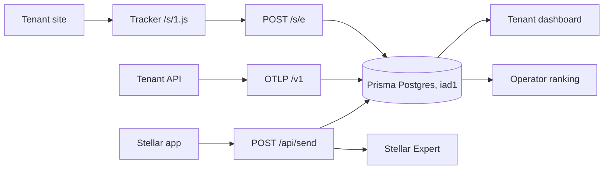

<h1 align="center">Stellog</h1>

<p align="center"><b>Web and API analytics for projects building on Stellar.</b></p>

<p align="center">
  <a href="https://stellog-eta.vercel.app"><b>Live demo</b></a> ·
  <a href="https://youtu.be/5XeM1qUk6NI"><b>Walkthrough (4:04)</b></a> ·
  <a href="docs/architecture.md"><b>Architecture</b></a> ·
  <a href="docs/hosting.md">Self-host</a> ·
  <a href="docs/status.md">Status</a> ·
  <a href="https://github.com/umami-software/umami">Umami 3.5.0</a>
</p>

Stellog is a multi-tenant analytics service for Stellar projects. A project gets a private view of its pageviews and its API traffic. An SCF operator can rank every project. The store is PostgreSQL. Stellog holds no funds and no tenant secret key.

It is [Umami](https://github.com/umami-software/umami) 3.5.0 (commit `b18d514`) with a Stellog landing page, password reset, Freighter and xBull sign-in, and a separate operator door. Built in public for the Stellar Community Fund RFP *Web and API Analytics for Stellar Ecosystem Projects* (SCF #46).

## Watch the walkthrough

[Stellog: Privacy-First Web & API Analytics for Stellar (Live Mainnet Walkthrough)](https://youtu.be/5XeM1qUk6NI) (4:04). It unlocks a mainnet wallet, adds USDC and EURC trustlines, sends and receives payments, and shows each event in the ledger and the realtime feed. It also shows the events view, the tracking snippet, the API ingest key, the operator view, and project comparison.

## The problem

A Stellar project ships a site and an API, then has no shared place to see who arrived, which routes are slow, or whether a wallet, trustline, or payment actually happened. Generic analytics keeps raw addresses in URLs, sets cookies, and cannot tell one tenant from another. An operator who funds those projects cannot compare them without logging into each one.

## What Stellog does

- **A pinned tracker.** Tenants include `public/s/1.js`. The snippet sets a sha384 integrity hash. The script sets no cookie and does not fetch more code at runtime.
- **A web collector.** `POST /s/e` checks a signed nonce that lasts five minutes, checks Origin, rejects bots, and rate-limits by IP. On this path the IP is truncated before lookup, and city and region are not stored. The session salt rotates each UTC day.
- **An API collector.** Tenants send OpenTelemetry to `/v1/metrics`, `/v1/traces`, and `/v1/logs`. JSON ingest is live. Counters and latency histograms are kept. Trace and log bodies are not. Gzip has not been exercised.
- **Stellar sign-in.** Freighter or xBull, through Stellar Wallets Kit 2.8.0 bundled in `public/wallet.js`, signs a five-minute SEP-10 challenge. The address must already be linked to an email account. Wallet-only signup is not built.
- **A ledger of reported events.** A project can report `wallet_created`, `trustline_added`, `tx_sent`, and `tx_received`. Stellog stores the event name, network, asset, success, and hash, and links the hash to Stellar Expert. It does not submit the transaction and does not watch Horizon.
- **Route names without account data.** A Stellar G, C, or M address, a UUID, a hex hash, or a numeric id is replaced before the route is stored.
- **Two dashboards.** A tenant sees only their projects. An operator ranks every project. Operator keys are hashed, revocable, and limited to the ranking route.



## Reference integration

Obba on mainnet reports wallet, trustline, and payment events to the Obba website on Stellog. The reporter sends `network`, `asset`, `success`, and `hash`. It does not send a phone number or an amount. These three mainnet transactions from 19 Nov 2026 are the reference set:

| Event | Transaction |
| --- | --- |
| Wallet created | [`e2d5f396…a68c`](https://stellar.expert/explorer/public/tx/e2d5f396a76a984bd8a2709a3829b6375c5dbe6665045ac61b615c529a09a68c) |
| USDC trustline | [`0f20091c…8f0a`](https://stellar.expert/explorer/public/tx/0f20091cbb7bd01c6198952be7485e3e0074bce952187b50b6194bc76ea28f0a) |
| Payment of 2 USDC | [`ae635daa…505e`](https://stellar.expert/explorer/public/tx/ae635daac269925458649bfbd89bfbf7665189353aed237b60e3b0994780505e) |

Automatic capture of Wallets Kit events is out of scope. If a project does not send the event, the ledger stays empty.

## Where it runs

The shared demo is [stellog-eta.vercel.app](https://stellog-eta.vercel.app). Serverless functions run in `iad1` (US East, North Virginia). PostgreSQL is Prisma Postgres in the same region. Queries use `pooled.db.prisma.io`. There is no replica.

In Tranche 3, before the 12-month support window, the collector, the dashboard, and the database move onto the Linux VPS in [docs/hosting.md](docs/hosting.md): PostgreSQL on that same machine, with the daily backup script. The VPS provider and city are chosen at that move.

Row-level security is not enabled. Isolation is the application query and the ingest-key check. [docs/rls-decision.md](docs/rls-decision.md) records why. Anomaly detection is not built.

## Check what is claimed

| Check | What it shows |
| --- | --- |
| [docs/architecture.md](docs/architecture.md) | The same status, salt, wallet, and residency sentences as the form. |
| [docs/status.md](docs/status.md) | The 15 Nov 2026 smoke: what was built, partial, or planned. |
| `openssl dgst -sha384 -binary public/s/1.js \| openssl base64 -A` | The tracker hash a tenant can recompute. It must match `src/stellog/tracker-pin.json`. |
| `GET /api/health` on the demo | `{"ok":true}` when Postgres answers. `GET /api/heartbeat` only proves the process is up. |
| `pnpm test` | Unit tests. They are not a production load test. |

## Limits today

- OpenTelemetry gzip has not been exercised. Protobuf traces were accepted once, in the 15 Nov 2026 smoke.
- Wallet sign-in requires an email account first. There is no wallet-only signup.
- The ledger stores extra `amount` or `phone` strings if a reporter sends them. Obba does not.
- There is no second region, no anomaly engine, and no installed prune timer on the Vercel deploy.
- Password-reset email is not built. In development the reset link is printed by the server.

## Run

```bash
cp .env.example .env
pnpm install
pnpm dev
```

Open http://127.0.0.1:3000. Sign in at `/login`. SCF operators use `/operator/login`.

The seeded admin is `admin` / `umami`. The first sign-in asks for a new password.

Set `DATABASE_URL` and `APP_SECRET` in `.env`. Apply the database with `pnpm exec prisma migrate deploy`. For wallet sign-in, set `STELLAR_AUTH_SECRET` to a Stellar secret key. Without it, development uses a temporary key and password-reset links are printed by the server.

## Layout

```
src/app          Umami screens, plus Stellog sign-in, reset, wallets, and dashboards
src/app/api      the API, including /s/e, /v1/*, and /api/send
src/stellog      route normalizer, tracker pin, ledger, privacy
public/s/1.js    pinned tracker
public/wallet.js Stellar Wallets Kit 2.8.0, Freighter and xBull only
marketing        landing, docs, pricing, privacy
prisma           Umami schema, plus reset links and linked wallets
docs             architecture, hosting, status, runbooks
```

MIT licensed. Umami © Umami Software, Inc.
